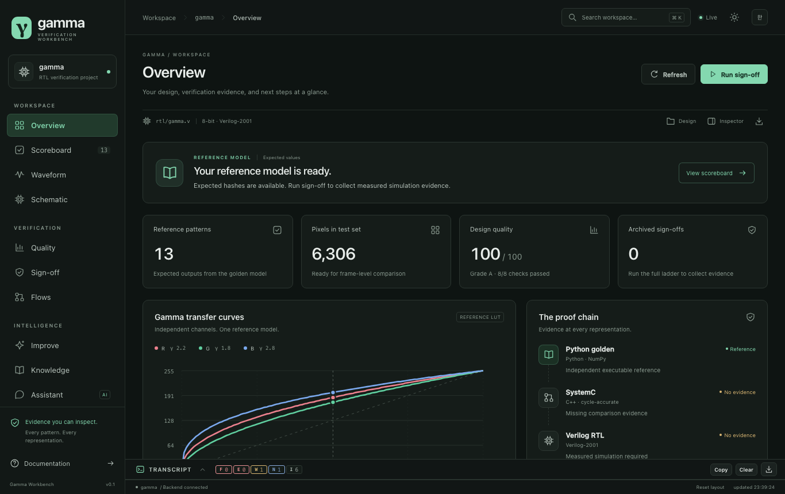
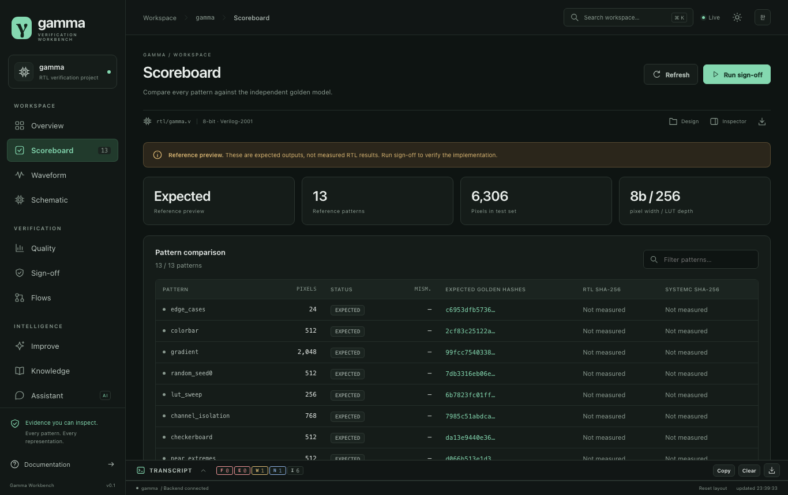
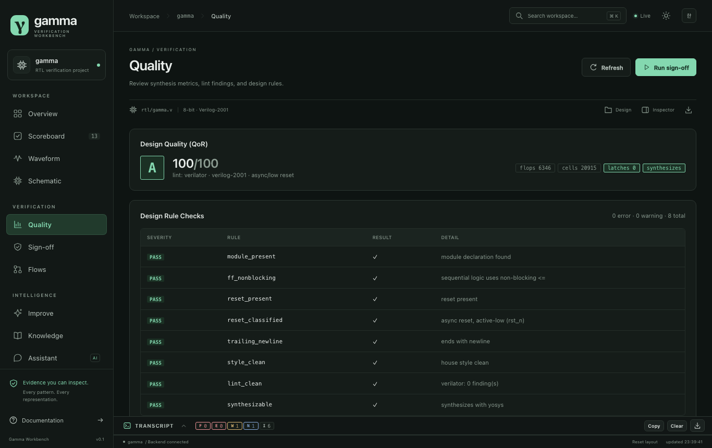
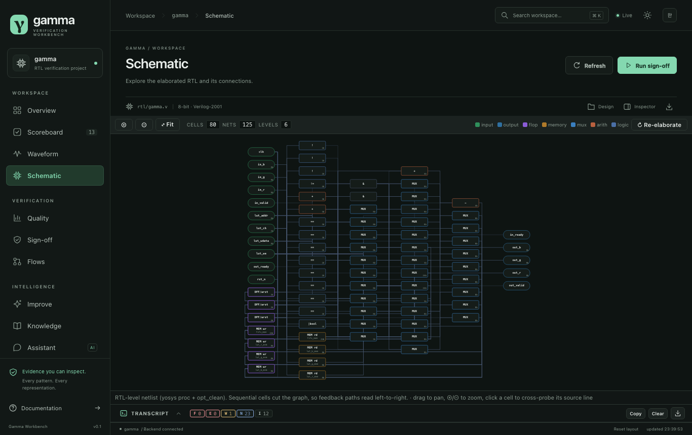

# hls-rtl — Gamma Verification Workbench

**An AI agent can write plausible RTL. It cannot tell you whether the RTL is
right.** That is the gap this project closes.

Spec2RTL-style agents generate HDL from a specification and then have nothing to
check it against — no executable reference, so "the tests the agent also wrote
pass" is the whole argument. This repository supplies the missing half: an
**executable oracle**, and a loop that proves each representation against it.

```
           spec / uArch delta                    docs/UARCH.md
                    │
                    ▼
            ┌───────────────┐
            │  plan (LLM)   │  steps tagged NEW / MODIFIED / UNCHANGED
            └───────┬───────┘
                    ▼
     golden (Python, numpy)  ◄────── the oracle: defines the expected values
                    │
        ┌───────────┴───────────┐
        ▼                       ▼
   SystemC (C++)            RTL (Verilog)
        │                       │
        └───────────┬───────────┘
                    ▼
         3-way bit-exact scoreboard        SHA-256 per frame, per pattern
                    │
          pass ─────┴───── fail
           │                │
      sign-off         reflection ──► which stage is at fault ──► re-plan
```

The claim is narrow and checkable: **for every pattern in the test set, the
Python golden, the SystemC model and the Verilog RTL produce byte-identical
output, and the SHA-256 of each frame proves it.** Not "the tests pass" —
*these three independent implementations agree, and here is the hash.*

---

## Quick start

```sh
python3.11 -m venv .venv && source .venv/bin/activate
pip install -r requirements.txt -r api/requirements.txt

python -m pytest tests/ -q                                # L0: golden model + test set, no simulator
./scripts/run_3way.sh                                     # the full proof (needs Verilator; SystemC optional)

# the workbench UI — two terminals
uvicorn api.server:app --host 127.0.0.1 --port 8012       # api-server
cd frontend && npm install && npm run dev                 # dashboard on http://127.0.0.1:5173
```

See [Run it](#run-it) for the per-layer commands and the tool prerequisites.

## Screens

<table>
<tr>
<td></td>
<td></td>
</tr>
<tr>
<td><b>Overview</b> — the thesis and the live proof chain: Python golden → SystemC → Verilog RTL, with an honest "no evidence" state until sign-off has run.</td>
<td><b>Scoreboard</b> — 13 patterns, one SHA-256 per frame. Shown here in the expected-only state (before a sign-off run fills in the measured RTL/SystemC columns).</td>
</tr>
<tr>
<td></td>
<td></td>
</tr>
<tr>
<td><b>Quality</b> — verilator lint + yosys synthesis folded into a 0–100 QoR score and design-rule checks, calibrated for Verilog-2001.</td>
<td><b>Schematic</b> — the elaborated netlist (yosys <code>proc + opt_clean</code>) drawn in the browser; click a cell to cross-probe its source line.</td>
</tr>
</table>

---

## Why a golden model is the right oracle

- **It is executable.** A specification can be misread; a reference
  implementation either produces the bytes or it does not.
- **It is independent.** numpy in Python shares no code, no author-time
  assumptions, and no failure modes with a Verilog FIFO.
- **It is untimed.** It cannot express a handshake bug, which is precisely why
  comparing against it isolates *value* correctness from *timing* correctness.
  Backpressure then changes ordering-in-time but must not change the hash.
- **It is cheap to re-run**, so it can gate every change rather than a release.

The per-channel gammas are deliberately different (R=2.2, G=1.8, B=2.8). With
identical LUTs a crossed-channel bug produces identical output and passes
silently — the asymmetry is what makes the oracle able to see it.

## What the workbench adds on top

Each capability exists because a generate-then-hope loop lacks it:

| # | Capability | The gap it closes | Where |
|---|---|---|---|
| 1 | Progressive-coding oracle | NL→C++→RTL has no ground truth at any rung | `api/progressive.py` |
| 2 | Golden-as-oracle contract | the hashes a candidate must reproduce | `api/oracle.py` |
| 3 | RTL segment traceability | regenerate only what changed | `api/rtl_segments.py` |
| 4 | Planner | spec delta → tagged, reviewable steps | `api/agents.py` |
| 5 | Adaptive reflection | a failure names its own root stage | `api/reflection.py` |
| 6 | Graph RAG | structure-aware grounding | `api/graph_rag.py` |
| 7 | Equivalence (LEC) | old RTL ≡ new RTL, proven not sampled | `api/equiv.py` |
| + | Knowledge base | answers cite the passage behind them | `api/knowledge.py` |

And an honesty rule that runs through all of it: **a skipped stage is missing
evidence, not a pass.** The regression runs under Verilator, which is 2-state,
so it cannot see X-propagation or reset-initialisation bugs — the UI says so on
the scoreboard rather than letting 13/13 imply more than it proves.

---

## The design under verification

Per-channel gamma correction: 1 pixel/cycle, ready/valid, 8b→8b, with an elastic
FIFO that decouples the two handshakes so there is no combinational
`out_ready → in_ready` path.

Full specification: **[`docs/UARCH.md`](docs/UARCH.md)** — interfaces, block
diagram, occupancy control, latency/throughput with measured numbers, the
Δ-propagation table, and an explicit non-goals list.

## Layout

```
docs/UARCH.md              microarchitecture spec — the planner's design input
golden/gamma_golden.py     numpy reference (the oracle)
rtl/gamma.v                Verilog-2001 DUT, 1-cycle latency, ready/valid
systemc/gamma_sc.{h,cpp}   cycle-accurate SystemC mirror
tb/test_gamma.py           cocotb 3-way scoreboard + directed protocol tests
tb/test_set.py             canonical pattern registry (append-only) + LUTs
tests/                     pytest unit tests (golden, stimulus, test set)
scripts/run_3way.sh        end-to-end driver
skills/                    agent skills, versioned here and synced to the gateway
api/                       FastAPI: scoreboard, QoR, sign-off, waveform,
                           schematic, knowledge base, agent proxy
frontend/                  EDA-style workbench UI
TESTPLAN.md                L0/L1/L2 layer rationale, coverage, known gaps
```

## Run it

```sh
python3.11 -m venv .venv && source .venv/bin/activate
pip install -r requirements.txt          # numpy, cocotb<2.0, pytest
pip install -r api/requirements.txt

./scripts/run_3way.sh                    # the full proof: unit → SystemC → RTL

# individually
python -m pytest tests/ -q               # L0: no simulator needed
cd tb && make                            # L1+L2: directed + 3-way (verilator)
cd tb && make SIM=icarus                 # 4-state cross-check (X/Z, reset)
sby -f formal/gamma.sby bmc              # bounded proof of the handshake invariants

# the workbench
uvicorn api.server:app --host 127.0.0.1 --port 8012
cd frontend && npm install && npm run dev
```

```sh
scripts/build_systemc.sh                 # the third model (brew install systemc)
sby -f formal/gamma.sby prove            # unbounded proof of the handshake
```

Prerequisites: Python 3.10+, Verilator ≥ 5.0, yosys (QoR/LEC/schematic), and —
each closing one rung of evidence — SystemC (third model), Icarus (4-state),
SymbiYosys (formal). **A missing tool degrades exactly one stage and says so**;
it never fails the gate and never passes silently. The SystemC comparison is
*skipped, not failed*, when `build/sc_out.txt` is absent, and a skip is missing
evidence, not a pass.

## Extending

- **Precision / depth change** — the Δ-propagation drill: `PIXEL_W`/`LUT_SIZE`
  must move together in `gamma_golden.py`, `gamma.v` and `gamma_sc.h`.
  `docs/UARCH.md` §7 has the table.
- **New pattern** — append to `tb/test_set.py`. Order is a contract:
  `build/sc_out.txt` is consumed sequentially, so never insert or reorder.
- **Stronger evidence** — `GET /improve/audit` ranks what is missing, and the
  gate now runs what used to be on that list: the SystemC rung, a 4-state pass
  under Icarus, an unbounded formal proof of the handshake, the non-default
  `LUT_SYNC_READ=1` configuration, and a mutation campaign that measures whether
  any of it would catch a bug.

## License

[MIT](LICENSE).
